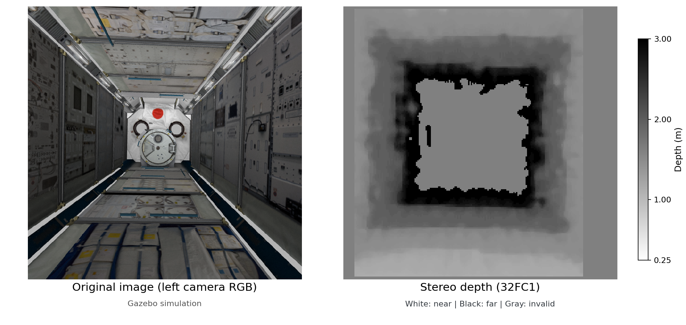

<a name="readme-top"></a>

[JA](README.md) | [EN](README.en.md)

# intball2_stereo

<!-- Table of Contents -->
<details>
  <summary>Table of Contents</summary>
  <ol>
    <li>
      <a href="#overview">Overview</a>
    </li>
    <li>
      <a href="#usage">Usage</a>
      <ul>
        <li><a href="#starting-the-node">Starting the node</a></li>
        <li><a href="#topics">Topics</a></li>
      </ul>
    </li>
  </ol>
</details>

## Overview

This package computes stereo disparity from the left and right Int-Ball2 camera images and publishes a depth image (and, optionally, a point cloud).

<p align="center">
  
</p>

<p align="right">(<a href="#readme-top">back to top</a>)</p>

## Usage

### Starting the node

Launch `stereo.launch.py`.

```sh
ros2 launch intball2_stereo stereo.launch.py
```

- Precision profile
  - Refines the depth with finer images, so the processing load increases.
  ```sh
  ros2 launch intball2_stereo stereo.launch.py precision:=true
  ```
- Point cloud
  - Not published by default. Set `points.publish_points: true` to publish it.
  - It can also be enabled while the launch is running:
  ```sh
  ros2 param set /stereo_node points.publish_points true
  ```

<p align="right">(<a href="#readme-top">back to top</a>)</p>

#### Parameters

The values below are those in the YAML files loaded by the launch. Entries marked "same" in the "Precision" column are shared with the default profile.

**Image processing, depth and point cloud**

| Parameter | Default | Precision | Description and accepted values |
| --- | --- | --- | --- |
| `camera.calibration_mode` | `gazebo_negative_5cm` | same | How calibration is handled. `gazebo_negative_5cm` for the existing Gazebo setup, `camera_info` for ordinary CameraInfo |
| `camera.input_geometry` | `already_rectified` | same | State of the input images. `already_rectified` for rectified images, `raw` for unrectified images |
| `processing.downsample` | `4` | same | Image downsampling factor: `1`, `2` or `4`. An 800×800 input is downsampled to 200×200 by default |
| `processing.opencv_threads` | `1` | `4` | Number of OpenCV threads, `1` to `64` |
| `processing.roi_left_px` | `0` | same | Width excluded from the left edge of the processing area (in output-image pixels) |
| `processing.roi_right_px` | `0` | same | Width excluded from the right edge of the processing area (in output-image pixels) |
| `processing.roi_top_px` | `0` | same | Width excluded from the top edge of the processing area (in output-image pixels) |
| `processing.roi_bottom_px` | `0` | same | Width excluded from the bottom edge of the processing area (in output-image pixels) |
| `depth.min_depth_m` | `0.25` | same | Lower limit of the published depth (m) |
| `depth.max_depth_m` | `3.0` | same | Upper limit of the published depth (m) |
| `points.publish_points` | `false` | same | Publishes a point cloud on `/stereo/points` when `true` |
| `points.layout` | `organized` | same | `organized` keeps the image's rows and columns, `compact` outputs only valid points |
| `points.stride` | `1` | same | Point-thinning interval, for `compact`. Must be `1` for `organized` |

The ROI values apply to the rectified image. Depth outside the ROI becomes an invalid value (NaN), and the size of the output image does not change. Both YAML files are for the unrectified Gazebo CameraInfo. Do not use `gazebo_negative_5cm` together with the `*_fixed` CameraInfo. A real robot needs settings that match its calibration and image state.

**Left/right image matching**

These settings control the search for corresponding points in the left and right images. Values in pixels refer to the downsampled image. If you change the downsampling factor, also adjust the disparity search range to the measurement range you need.

| Parameter | Default and precision | Description and accepted values |
| --- | --- | --- |
| `matcher.min_disparity_px` | `-25` | Start of the disparity search (pixels) |
| `matcher.num_disparities_px` | `32` | Width of the disparity search (pixels). A positive multiple of 16 |
| `matcher.disparity_units` | `processed_pixels` | Unit of disparity. Only `processed_pixels` is accepted |
| `matcher.block_size_px` | `5` | Width of the matching window (pixels). An odd number from `3` to `255` |
| `matcher.uniqueness_ratio` | `10` | Margin required to accept a match candidate (%), `0` to `100` |
| `matcher.speckle_window_size_px` | `100` | Maximum area of isolated regions to remove (pixels). `0` disables it |
| `matcher.speckle_range_px` | `2` | Disparity difference treated as the same isolated region (pixels) |
| `matcher.disp12_max_diff_px` | `1` | Allowed difference between the left-to-right and right-to-left results (pixels). `-1` disables it |

**Refinement**

These settings are used when `refinement.enabled=true`. For the refinement downsampling factor, window size and search radius, start with the combination in the precision YAML.

| Parameter | Default | Precision | Description and accepted values |
| --- | --- | --- | --- |
| `refinement.enabled` | `false` | `true` | Enables additional depth refinement |
| `refinement.downsample` | `2` | `1` | Downsampling factor of the refinement image: `1`, `2` or `4`. It cannot be coarser than the matching image |
| `refinement.window_size_px` | `9` | `17` | Refinement window width (refinement-image pixels). An odd number from `3` to `31` |
| `refinement.search_radius_px` | `2` | `3` | Refinement search radius (refinement-image pixels), `1` to `8` |
| `refinement.min_texture_variance` | `1.0` | same | Lower limit of the image brightness variation required for refinement. A positive value |
| `refinement.min_correlation` | `0.7` | same | Lower limit of the image similarity for accepting a refinement result, `0` to `1` |

**Synchronization, communication and diagnostics**

| Parameter | Default and precision | Description and accepted values |
| --- | --- | --- |
| `sync.queue_size` | `5` | Number of inputs kept for synchronization, `1` to `1000` |
| `sync.max_interval_s` | `0.02` | Maximum time difference allowed among the four inputs (s), `0` to `1` |
| `qos.depth` | `5` | Number of messages kept in the communication queue, `1` to `1000` |
| `diagnostics.publish_interval_s` | `1.0` | Diagnostics publishing interval (wall-clock seconds), `0.01` to `60` |

Changing `topics.*`, `sync.*`, `qos.depth`, `diagnostics.publish_interval_s` or `processing.opencv_threads` requires restarting the node. The other parameters in the tables can also be changed with `ros2 param set`. To change several related values together, edit the YAML and launch again.

<p align="right">(<a href="#readme-top">back to top</a>)</p>

### Topics

The values of `topics.*` are absolute topic names (names starting with `/`).

| Parameter | Direction | Default topic | Type | Description |
| --- | --- | --- | --- | --- |
| `topics.left_image` | input | `/camera_left/image_raw` | `sensor_msgs/Image` | Left image |
| `topics.right_image` | input | `/camera_right/image_raw` | `sensor_msgs/Image` | Right image |
| `topics.left_camera_info` | input | `/camera_left/camera_info` | `sensor_msgs/CameraInfo` | Left camera calibration |
| `topics.right_camera_info` | input | `/camera_right/camera_info` | `sensor_msgs/CameraInfo` | Right camera calibration |
| `topics.depth` | output | `/stereo/depth` | `sensor_msgs/Image` | Depth image (m) |
| `topics.camera_info` | output | `/stereo/camera_info` | `sensor_msgs/CameraInfo` | Calibration matching the output image |
| `topics.points` | output | `/stereo/points` | `sensor_msgs/PointCloud2` | XYZ point cloud, published when `points.publish_points=true` |
| `topics.timing` | output | `/stereo/timing` | `diagnostic_msgs/DiagnosticArray` | Simulation-time delay from image capture to just before the depth is published |
| `topics.diagnostics` | output | `/diagnostics` | `diagnostic_msgs/DiagnosticArray` | Processing status and errors |

Publish the images and CameraInfo every frame, and keep the time difference among the four inputs within `sync.max_interval_s`. Timestamps must increase monotonically. If the simulation clock is rewound, restart the node. In the ordinary `camera_info` mode, make the image and CameraInfo frames the same optical frame.

The inputs and all outputs except diagnostics use best-effort / volatile QoS. Subscribers of the depth and other outputs must also use best-effort. `/diagnostics` is reliable / volatile.

<p align="right">(<a href="#readme-top">back to top</a>)</p>
